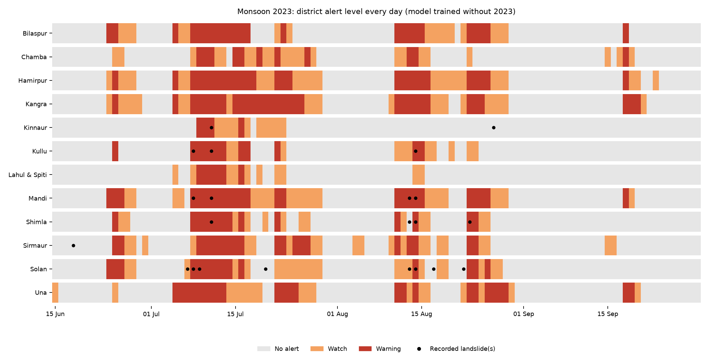

# Landslide early warning for Himachal Pradesh

Every monsoon, landslides in Himachal Pradesh (HP), a mountain state in north India, block roads, cut off villages and take lives. Most of them are triggered by heavy rain.

This project is a **free, automatic early-warning system**. Every morning it looks at the rain that has fallen and the rain that is forecast, combines it with what we know about each slope (steepness, rock type, vegetation, rivers, roads), and tells each of HP's 12 districts whether today and tomorrow look **safe**, worth a **Watch**, or need a **Warning**.

**See today's outlook (updated every morning):** https://suraj-raj-7.github.io/Landslide-Prediction-System/


*The system replayed over the whole 2023 monsoon with a model that had never seen 2023. Each row is a district, each column a day. Black dots are recorded landslides; most of them fall on orange or red days.*

It was built as a course project (M.Tech ICTD, IIT Delhi, 2026). It is a **research prototype, not an official warning service**: official warnings in India come from the India Meteorological Department (rain) and the Geological Survey of India (landslides).

---

## How it works, in five steps

1. **Learn from the past.** We collected 981 dated landslides from 2005–2026 in Himachal Pradesh, Uttarakhand and Jammu & Kashmir (HP alone has too few dated events to learn from).
2. **Describe every landslide.** For each one we measured 42 things with Google Earth Engine: the slope, rock and soil type, distance to rivers, roads and faults, vegetation, and the rain on the day and in the weeks before.
3. **Show the model the difference between "landslide" and "no landslide".** We added carefully chosen non-landslide examples: the same places on dry days, and similar slopes on stormy days that did *not* slide. A Random Forest model learned to tell them apart.
4. **Test it honestly.** Every test hides whole years from the model, so it is always scored on storms it has never seen. We also replayed 16 past storm days, 16 quiet days, and two entire monsoons day by day.
5. **Run it every morning.** A small program on GitHub Actions scores all 55,253 squares (1 km × 1 km) of HP, puts each district at no alert / Watch / Warning, emails the result and publishes the web page above. It takes about one minute.

## What we found

| Test | Result |
|---|---|
| Past storm days (16 days, 44 districts with recorded landslides) | **86%** of those districts were on Watch on the day or the day before |
| Quiet monsoon days (192 district-days) | Watch on **15%**, Warning on **1.6%** |
| Whole monsoon 2023, replayed day by day | **17 of 22** district-days with a recorded landslide were on alert; **12** of them already the day before |
| Whole monsoon 2025 | **24 of 35** caught; **20** of them the day before |

**Honest limits.**
- **It alerts often:** about 1 monsoon day in 3–4 per district. Many of those days have no *recorded* landslide. Some are real landslides that nobody recorded; some are false alarms.
- **Satellite rain is coarse:** about 10 km per pixel. It can miss a storm on one side of a ridge, and finer free rain products did not do better.
- **Recorded landslides are mostly near roads,** so the system is most reliable near roads. Squares far from roads are shown faded ("lower confidence").

How the alert levels were chosen, in simple words: [docs/alert_rule_explained.md](docs/alert_rule_explained.md).

## Where to look

| If you want to... | Open |
|---|---|
| Understand the alerts in simple words | [docs/alert_rule_explained.md](docs/alert_rule_explained.md) |
| See how it did over whole monsoons | [docs/monsoon_replay_explained.md](docs/monsoon_replay_explained.md) |
| Know how it would be tested with real users | [docs/impact_assessment.md](docs/impact_assessment.md) |
| Read the whole story of the project | [docs/project_history.md](docs/project_history.md) |
| Find any document | [docs/README.md](docs/README.md) |
| Find any script | [src/README.md](src/README.md) |
| Find any data file | [data/README.md](data/README.md) |
| See every change and why it was made | [CHANGELOG.md](CHANGELOG.md) |

```
src/                Python code: data building, model training, tests, and the daily system (live_*.py)
data/               Input tables and results of every step (see data/README.md)
docs/               Explanations, technical documentation, figures, presentation
models/             The trained models used by the daily system
.github/workflows/  The daily run on GitHub Actions
```

## Run it yourself

You need Python 3.13 and a free [Google Earth Engine](https://earthengine.google.com/) account with a Cloud project.

```bash
python -m venv .venv
.venv/Scripts/python -m pip install -r requirements.txt     # on Linux/Mac: .venv/bin/python
.venv/Scripts/earthengine authenticate                       # once per computer
```

Then run today's outlook (writes the web page into `site/`, sends no email):

```bash
.venv/Scripts/python -W ignore src/live_03_daily_run.py --no-email
```

The code uses our Earth Engine project (`idyllic-return-468714-j4`). To use your own, change `PROJECT` in `src/live_03_daily_run.py`. The daily run only reads public datasets plus the files in this repository. Scripts from the research phases also read Earth Engine assets in our account. How the daily GitHub run is set up (robot login, email, web page): [docs/daily_system_setup.md](docs/daily_system_setup.md).

## Data sources
All free and public: NASA GPM IMERG (satellite rain), NOAA GFS (rain forecast), ECMWF ERA5-Land (snow), Copernicus GLO-30 (elevation), MERIT Hydro (rivers), OpenStreetMap (roads), Geological Survey of India maps (rock types, faults, landforms), ESA WorldCover and Landsat (land cover, vegetation), geoBoundaries (districts). Landslide records: the Geological Survey of India's Bhusanket inventory and the NASA Global Landslide Catalog. Full references are in [the technical documentation](docs/ICTD_Landslide_Feature_Stack_Documentation.md).

## Credits
Course project for ICTD (Information and Communication Technologies for Development), M.Tech, IIT Delhi, 2026, taught by Prof. Aaditeshwar Seth.
Team: Suraj Raj, Siddhesh Pohare. NGO mentor: Betwa Solutions.
